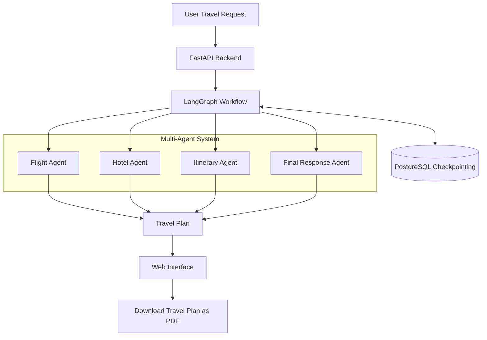

# ✈️ Triply — A Multi-Agent Travel Planner

An open-source AI-powered travel planner that transforms natural-language travel requests into practical travel plans with flight suggestions, hotel recommendations, and personalized day-by-day itineraries.

Built with **LangGraph, LangChain, Groq, and FastAPI**, Triply uses a multi-agent architecture to simplify the travel-planning process.

<p align="center">
  <a href="https://triply-a-multi-agent-travel-planner-with.onrender.com/">
    <strong>🌐 Try Triply Live</strong>
  </a>
</p>

---

## 📸 Application Preview


*Triply's web interface — enter your travel requirements in natural language and generate your travel plan.*

---

## 🚀 Why Triply?

Planning a trip often requires switching between multiple websites to research flights, discover hotels, and organize daily activities.

Triply brings these tasks together in one application using specialized AI agents coordinated through LangGraph.

Simply describe your travel requirements, such as:

> Plan a 7-day Thailand trip from Bangladesh with budget hotels and sightseeing.

Triply processes your request and generates a structured travel plan containing flight suggestions, hotel ideas, and a day-by-day itinerary.

## ✨ Features

- ✈️ **Flight Research:** Flight research using the AviationStack API.
- 🏨 **Hotel Discovery:** Hotel research and suggestions using Tavily Search.
- 🤖 **Multi-Agent Architecture:** Specialized agents coordinated through LangGraph.
- 🧠 **LLM-Powered Planning:** Generates travel recommendations using Groq-hosted language models.
- 🗓️ **Travel Itinerary:** Generates structured, day-by-day travel plans.
- 💾 **Conversation Persistence:** PostgreSQL-based LangGraph state persistence.
- 📄 **PDF Export:** Download the generated travel plan as a PDF.
- 🌐 **Web Interface:** Simple and responsive frontend built with HTML, CSS, and JavaScript.
- ⚡ **FastAPI Backend:** Provides the application backend and API endpoints.

## 🏗️ Architecture

Triply uses a multi-agent architecture where specialized agents handle different parts of the travel-planning process.

### Agent Responsibilities

| Agent | Responsibility |
|---|---|
| Flight Agent | Researches flight information using AviationStack |
| Hotel Agent | Searches for hotel information using Tavily |
| Itinerary Agent | Generates a day-by-day travel itinerary |
| Final Response Agent | Prepares the final travel-planning response |

### High-Level Architecture



*This diagram illustrates the high-level components. The actual execution order and state transitions are defined by the LangGraph implementation.*

## 🛠️ Tech Stack

| Category | Technology |
|---|---|
| Programming Language | Python |
| Backend Framework | FastAPI |
| AI Orchestration | LangGraph |
| LLM Framework | LangChain |
| LLM Provider | Groq |
| Flight Research | AviationStack API |
| Web Search | Tavily API |
| Database | PostgreSQL |
| Frontend | HTML, CSS, JavaScript |
| Template Engine | Jinja2 |
| Package Manager | uv |
| Containerization | Docker |
| Deployment | Render |

## 📂 Project Structure

```text
Triply/
│
├── backend/
│   ├── __init__.py
│   ├── agents.py
│   ├── app.py
│   ├── config.py
│   └── main.py
│
├── integrations/
│   ├── __init__.py
│   └── llm/
│       ├── __init__.py
│       └── groq.py
│
├── tools/
│   ├── __init__.py
│   ├── flight_tool.py
│   └── tavily_tool.py
│
├── static/
│   ├── script.js
│   └── style.css
│
├── templates/
│   └── index.html
│
├── docs/
│   └── images/
│       └── triply-homepage.png
│
├── .dockerignore
├── .env.example
├── .gitignore
├── .python-version
├── Dockerfile
├── LICENSE
├── pyproject.toml
├── requirements.txt
└── uv.lock
```

## ⚙️ Installation and Setup

Follow these steps to run Triply locally.

### Prerequisites

Make sure you have installed:

- Python 3.12
- Git
- uv
- PostgreSQL
- Docker (optional)

### 1. Clone the Repository

```bash
git clone <YOUR_GITHUB_REPOSITORY_URL>
```

Navigate to the project directory:

```bash
cd Triply
```

### 2. Install Dependencies

Install the project dependencies using uv:

```bash
uv sync
```

### 3. Configure Environment Variables

Create a `.env` file in the project root directory.

You can use `.env.example` as a reference:

```bash
cp .env.example .env
```

Add your API credentials and database configuration to the `.env` file.

Example:

```env
GROQ_API_KEY=your_groq_api_key
TAVILY_API_KEY=your_tavily_api_key
AVIATIONSTACK_API_KEY=your_aviationstack_api_key
DATABASE_URL=your_postgresql_connection_string
DEFAULT_ORIGIN_IATA="DAC"
```

**Important:** Use the exact environment variable names defined in your project's `config.py` and `.env.example`. Never commit your actual API keys or database credentials to GitHub.

### 4. Configure PostgreSQL

Make sure your PostgreSQL database is running and that your database connection string is correctly configured in `.env`.

### 5. Run the Application

Start the FastAPI application using Uvicorn:

```bash
uv run uvicorn backend.app:app --reload
```

Open your browser and visit:

```text
http://127.0.0.1:8000
```

You should now be able to access Triply locally.

## 🐳 Docker

Triply includes a Dockerfile for containerized deployment.

### Build the Docker Image

```bash
docker build -t triply .
```

### Run the Container

```bash
docker run -p 8000:8000 --env-file .env triply
```

Open:

```text
http://localhost:8000
```

**Note:** PostgreSQL must be accessible from the container. If your database runs on your host machine, configure the database connection using a hostname reachable from the container.

## 📄 Download Travel Plans

Triply allows users to download their generated travel plans in PDF format.

This makes it easier to keep a copy of the travel itinerary and refer to it while planning or organizing a trip.

## 🌍 Live Demo

Try the deployed application:

**[Launch Triply](https://triply-a-multi-agent-travel-planner-with.onrender.com/)**

## 🔐 Environment Variables

The application requires API credentials and database configuration.

| Variable | Description |
|---|---|
| `GROQ_API_KEY` | Groq API authentication |
| `TAVILY_API_KEY` | Tavily Search API authentication |
| `AVIATIONSTACK_API_KEY` | AviationStack API authentication |
| `DATABASE_URL` | PostgreSQL database connection |
| `DEFAULT_ORIGIN_IATA` | "DAC" |
*Check `.env.example` and `backend/config.py` for the exact variable names required by your implementation.*

## 🗺️ Future Improvements

Potential areas for further development:

- [ ] Integrate Model Context Protocol (MCP) servers.
- [ ] Implement Retrieval-Augmented Generation (RAG).
- [ ] Improve travel recommendation personalization.
- [ ] Add additional travel information providers.
- [ ] Improve agent evaluation and workflow reliability.
- [ ] Expand itinerary customization capabilities.

## 🤝 Contributing

Contributions, suggestions, and feature requests are welcome.

If you would like to contribute:

1. Fork the repository.
2. Create a new feature branch.
3. Implement your changes.
4. Commit your changes with a descriptive commit message.
5. Open a Pull Request.

## 📜 License

This project is open source. See the [LICENSE](LICENSE) file for licensing details.

## 👨‍💻 Author

**Salauddin Al Rifat**

- GitHub: [@Rifat211-debug](https://github.com/Rifat211-debug)

---

<p align="center">
  Built with ❤️ using LangGraph, LangChain, and FastAPI.
  <br>
  <strong>Triply — Plan Your Perfect Trip with AI.</strong>
</p>